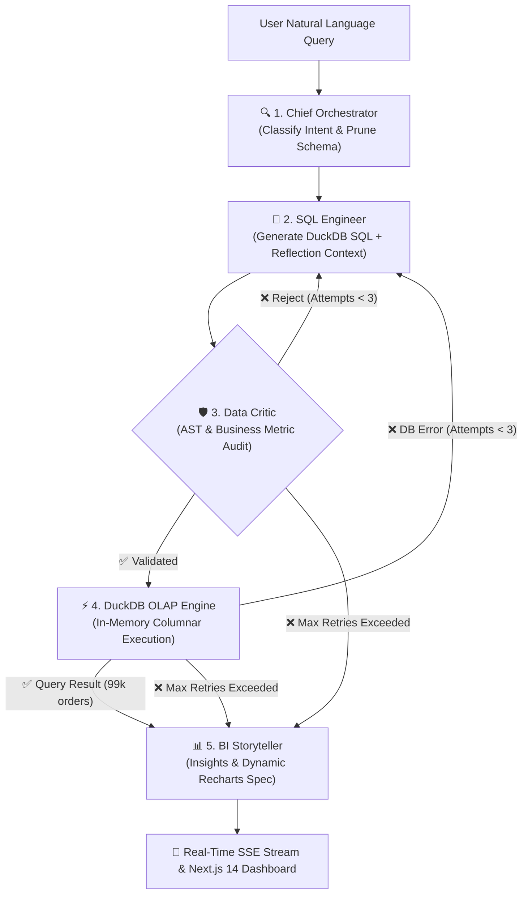

# 📊 Autonomous Business Intelligence Multi-Agent System (Olist BI)

[](https://github.com/abijithrs/bi-multi-agent/actions)
[](https://www.python.org/)
[](https://nextjs.org/)
[](https://duckdb.org/)
[](https://www.postgresql.org/)
[]()

An enterprise-grade, conversational **Autonomous Business Intelligence (BI) Multi-Agent System** that translates natural language business questions into strictly validated DuckDB analytical queries, executes them in-memory against a 100,000-order PostgreSQL database via `postgres_scanner`, self-heals syntax or schema errors in real time, and streams interactive Recharts dashboards via Server-Sent Events (SSE).

---

## 🌟 Key Architecture & Highlights

- **Zero-Hallucination AST Guardrails**: Abstract Syntax Tree parsing via `sqlglot` rejects destructive commands (`DROP`, `DELETE`, `UPDATE`, `INSERT`, `ALTER`, `TRUNCATE`), multi-statement injection exploits, and unknown tables.
- **Microsecond Columnar OLAP**: Embedded DuckDB attaches directly to containerized PostgreSQL in `READ_ONLY` mode via `postgres_scanner`, querying ~550,000 records in memory with zero data duplication.
- **4-Agent Collaborative Pod (LangGraph)**:
  1. **🔍 Chief Orchestrator**: Prunes the 7-table schema to only relevant tables and business metrics.
  2. **📝 SQL Engineer**: Generates few-shot DuckDB SQL grounded in `semantic_layer.yaml`.
  3. **🛡️ Data QA Critic**: Adversarially evaluates query safety, join keys, and business logic.
  4. **📊 BI Storyteller**: Synthesizes executive bullet points and dynamic Recharts JSON specs.
- **Autonomous Self-Healing Loop**: If a query encounters a database error, the agent feeds the error traceback back into the reflection loop to self-correct (up to 3 retries).
- **Adaptive Visualization Frontend**: Next.js 14 App Router, TypeScript, and Tailwind CSS dynamically rendering `<BarChart>`, `<LineChart>`, `<AreaChart>`, `<PieChart>`, or `<MetricCard>`.

---

## 🏗️ System Workflow



---

## 🚀 Quick Start Guide

### 1. Prerequisites
- Docker Desktop (running)
- Python 3.12 (managed via `uv`)
- Node.js LTS (v20+)

### 2. Environment Configuration
```powershell
# Copy the environment file template
Copy-Item .env.example .env
```

### 3. Spin Up PostgreSQL & Seed Dataset
```powershell
# Start PostgreSQL 16 container
docker compose up -d

# Seed the ~550,000 records (99,441 orders)
uv run python backend/scripts/seed_olist.py
```

### 4. Run the Backend API
```powershell
# Run FastAPI server on port 8000
uv run uvicorn backend.app.main:app --reload --port 8000
```
- Swagger API Docs: [http://localhost:8000/docs](http://localhost:8000/docs)
- Health Check: [http://localhost:8000/health](http://localhost:8000/health)

### 5. Run the Next.js Frontend
```powershell
cd frontend
npm install
npm run dev
```
- Dashboard UI: [http://localhost:3000](http://localhost:3000)

---

## 🧪 Testing & Golden Evaluation Benchmark

Run the complete 45-test automated verification suite:

```powershell
uv run pytest -v
```

```
============================= test session starts =============================
backend/tests/test_agent.py ..........                                   [ 22%]
backend/tests/test_api.py ........                                       [ 40%]
backend/tests/test_chat_api.py ..                                        [ 44%]
backend/tests/test_config.py ..                                          [ 48%]
backend/tests/test_duckdb.py ...                                         [ 55%]
backend/tests/test_golden_benchmarks.py ..........                       [ 77%]
backend/tests/test_validator.py ..........                               [100%]
============================= 45 passed in 2.64s ==============================
```

---

## 📂 Repository Structure

```
bi-multi-agent/
├── backend/
│   ├── app/
│   │   ├── agent/             # LangGraph 4-agent pod & LLM factory
│   │   │   ├── nodes/         # Orchestrator, SQL Engineer, Critic, Executor, Storyteller
│   │   │   ├── graph.py       # State machine with 3-attempt reflection loop
│   │   │   ├── llm_factory.py # Gemini & Ollama dual provider + fallback
│   │   │   ├── prompts.py     # Agent system prompts & few-shot examples
│   │   │   └── state.py       # Pydantic AgentState & ChartSpec schemas
│   │   ├── api/v1/            # FastAPI routes: /chat, /query, /validate, /schema, /metrics
│   │   ├── core/              # Config, semantic_layer.yaml, and sqlglot validator
│   │   ├── db/                # DuckDB OLAP manager & PostgreSQL DDL schemas
│   │   └── main.py            # FastAPI entry point with CORS & Lifespan
│   ├── scripts/               # Automated Kaggle Olist ETL pipeline
│   └── tests/                 # 45 unit, integration, and benchmark tests
├── frontend/
│   ├── src/
│   │   ├── app/               # Next.js 14 App Router (page.tsx, layout.tsx, globals.css)
│   │   ├── components/        # AdaptiveChart, SQLInspector, AgentThinkingTimeline, MetricCardsGrid
│   │   ├── hooks/             # useAgentChat (SSE stream consumer over fetch)
│   │   └── types/             # TypeScript interfaces for charts, queries, and steps
│   └── package.json
├── docker/                    # Docker initialization scripts & read-only user setup
├── docs/                      # ARCHITECTURE.md & PROJECT_STATE_AND_RESUME_GUIDE.md
├── docker-compose.yml         # Containerized PostgreSQL 16
└── pytest.ini                 # Pytest configuration
```

---

## 📜 License
MIT License.