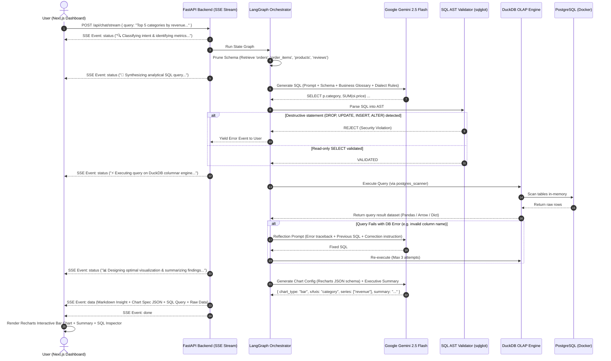
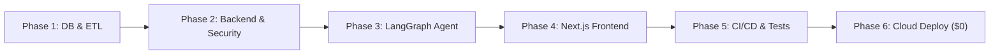

# 📊 Autonomous Business Intelligence Agent (Olist BI)
## Complete Architectural Specification & System Blueprint

---

## 🌟 1. Executive Summary & Project Vision

### What is this project?
An enterprise-grade, conversational **Business Intelligence (BI) & Analytics Agent** that translates complex natural language business questions into highly optimized, validated analytical SQL queries, executes them against an analytical data engine (PostgreSQL + DuckDB), self-heals in case of syntax or schema errors, and streams real-time insights paired with dynamic interactive data visualizations (charts, KPI cards, tables) back to the user.

### Key Goals
1. **Zero-Hallucination Querying**: Never run unvalidated or destructive queries. Schema grounding and AST parsing enforce strict read-only execution.
2. **Self-Healing Reflection Loop**: If a query encounters a database error or returns empty unexpected results, the agent inspects the database engine's error traceback, reflects on its mistakes, and corrects the SQL autonomously.
3. **Real-Time Streaming Transparency**: Users see the agent think step-by-step in real-time via Server-Sent Events (SSE).
4. **100% Free & Open-Source Stack ($0)**: Built using standard open-source tools without any paid cloud dependencies.

---

## 🔄 2. End-to-End User Journey

```
User Query: "What were our top 5 product categories by revenue in 2017, and did their customer review scores drop in peak holiday months?"
```



---

## 🏛️ 3. System Architecture & Component Design

### 3.1. Frontend Layer (`/frontend`)
* **Framework**: Next.js 14+ (App Router), TypeScript, Tailwind CSS.
* **Component System**: `shadcn/ui` (Radix primitives for accessible, high-performance UI).
* **Visualization Engine**: `Recharts` wrapped inside an **Adaptive Chart Renderer**:
  * Automatically switches between `<BarChart>`, `<LineChart>`, `<AreaChart>`, `<PieChart>`, or `<MetricCard>` based on the agent's recommended visualization schema.
* **Streaming Protocol**: Custom client-side streaming consumer using `ReadableStreamDefaultReader` over HTTP POST.

### 3.2. Backend API Layer (`/backend`)
* **Framework**: FastAPI (Python 3.11+ / 3.12).
* **Architecture**: Modular router architecture (`/api/v1/chat`, `/api/v1/datasets`, `/api/v1/health`).
* **Resilience Guardrails**:
  * **Exponential Backoff**: Decorator wrapping LLM calls with randomized jitter to handle Gemini Free Tier's 15 RPM limits cleanly.
  * **Deterministic Prompt Cache**: SHA-256 hash of `(prompt + schema_version)` cached locally (SQLite / in-memory) to prevent duplicate API calls during rapid UI testing.

### 3.3. The AI Agent Core (`/backend/app/agent`)
* **Orchestration**: `LangGraph` state graph with explicit node functions and conditional edges.
* **Nodes**:
  1. `classify_and_prune`: Extracts entity names and selects only the 3–4 relevant tables out of the schema.
  2. `generate_sql`: Prompts the LLM with few-shot examples, semantic metric formulas, and DuckDB SQL dialect rules.
  3. `validate_sql`: Uses `sqlglot` to parse the SQL Abstract Syntax Tree (AST), checking that only `SELECT` operations exist and table/column references match the schema.
  4. `execute_query`: Dispatches the sanitized SQL to DuckDB with a strict 5-second timeout.
  5. `reflect_and_heal`: If execution fails, catches the exact database error, injects it into a structured reflection prompt, and loops back to `generate_sql` (limited to 3 iterations).
  6. `synthesize_response`: Converts the tabular data into concise executive bullet points and emits a strictly typed Recharts JSON specification.

### 3.4. Data Storage & Execution Layer
* **Source of Truth**: PostgreSQL running in a Docker container.
* **Analytical Engine**: Embedded DuckDB inside the FastAPI process.
  * Uses DuckDB's `postgres_scanner` to query PostgreSQL directly in-memory.
  * Delivers 10x–100x faster aggregations (`SUM`, `AVG`, `GROUP BY`, window functions) than standard row-based PostgreSQL.
* **Security Isolation**:
  * A dedicated `bi_readonly` PostgreSQL user granted *only* `SELECT` permissions on schema tables.

---

## 🗄️ 4. Data Domain: Olist Brazilian E-Commerce

The dataset represents ~100,000 real e-commerce orders between 2016 and 2018.

### Core Tables & Relationships
1. **`customers`**: `customer_id`, `customer_unique_id`, `zip_code_prefix`, `city`, `state`.
2. **`orders`**: `order_id`, `customer_id`, `order_status` (delivered, shipped, canceled), `order_purchase_timestamp`, `order_delivered_customer_date`, `order_estimated_delivery_date`.
3. **`order_items`**: `order_id`, `order_item_id`, `product_id`, `seller_id`, `shipping_limit_date`, `price`, `freight_value`.
4. **`products`**: `product_id`, `product_category_name` (translated to English), `product_name_length`, `product_description_length`, `product_photos_qty`, `product_weight_g`.
5. **`order_payments`**: `order_id`, `payment_sequential`, `payment_type` (credit_card, boleto, voucher, debit_card), `payment_installments`, `payment_value`.
6. **`order_reviews`**: `review_id`, `order_id`, `review_score` (1 to 5), `review_comment_title`, `review_comment_message`, `review_creation_date`.
7. **`sellers`**: `seller_id`, `zip_code_prefix`, `city`, `state`.

### Key Business Metrics Defined in the Semantic Layer
* **Gross Merchandise Value (GMV) / Revenue**: `SUM(order_items.price)` for orders with status `delivered`.
* **Average Order Value (AOV)**: `SUM(order_items.price) / COUNT(DISTINCT orders.order_id)`.
* **On-Time Delivery Rate**: Percentage of orders where `order_delivered_customer_date <= order_estimated_delivery_date`.
* **Customer Satisfaction Score (CSAT)**: `AVG(order_reviews.review_score)`.
* **Seller Fulfillment Speed**: `AVG(order_delivered_customer_date - order_purchase_timestamp)`.

---

## 🛣️ 5. Progressive 6-Phase Implementation Roadmap



### Phase 1: Database & Data Ingestion
- Set up Docker Compose for PostgreSQL.
- Write Python ETL script (`scripts/seed_olist.py`) that downloads Olist CSVs, cleans null values, translates Portuguese category names to English, and seeds PostgreSQL.
- Verify DuckDB `postgres_scanner` connection and execute baseline benchmark queries.

### Phase 2: FastAPI Backend & Semantic Layer
- Initialize FastAPI project structure with dependency injection.
- Implement read-only database session management.
- Define `semantic_dictionary.yaml` mapping business metrics to SQL expressions and table relationships.
- Build query validation engine using `sqlglot`.

### Phase 3: LangGraph Agent & Self-Healing Loop
- Set up Google AI Studio (Gemini 2.5 Flash) API client with backoff and prompt caching.
- Build LangGraph state machine:
  * Schema context pruning.
  * Few-shot SQL generation.
  * Execution & error reflection loop (max 3 retries).
  * Visualization configuration synthesizer.
- Build SSE streaming endpoint (`GET/POST /api/v1/chat/stream`).

### Phase 4: Modern Next.js Frontend & Interactive Dashboards
- Create Next.js 14 project with Tailwind CSS and `shadcn/ui`.
- Build conversational chat interface with live thinking indicator.
- Build Recharts adaptive chart renderer (Bar, Line, Area, Pie, KPI Stat Cards).
- Add raw SQL drawer with syntax highlighting and CSV data export button.

### Phase 5: Testing, Git & CI/CD Pipelines
- Establish GitHub Flow (`feat/*` branches, Conventional Commits, PR reviews).
- Write `pytest` test suite:
  * SQL injection and destructive query rejection tests.
  * Agent golden evaluation benchmark (20 canonical business questions).
- Create `.github/workflows/ci.yml` running `ruff`, `mypy`, `pytest`, and `tsc --noEmit`.

### Phase 6: Production Hardening & Free Deployment
- Deploy PostgreSQL database on **Neon** or **Supabase** (free tier).
- Deploy FastAPI backend on **Render** or **Koyeb** (free tier).
- Deploy Next.js frontend on **Vercel** (free tier).
- Enforce rate limiting, query timeouts, and CORS security.

---

## 🛡️ 6. Golden Rules & Architectural Commandments

1. **The Database is Sovereign**: Never trust the LLM's SQL. Always parse its AST with `sqlglot` and enforce database-level read-only user permissions.
2. **Never Overload Context**: Only provide relevant table schemas in the prompt. Injecting the entire database schema degrades accuracy.
3. **Fail Gracefully**: If 3 self-healing attempts fail, output a clear, friendly explanation detailing what the database struggled with, rather than a cryptic 500 error.
4. **Clean Git History**: Every feature branch corresponds to one specific milestone. Never commit broken code to `main`.
